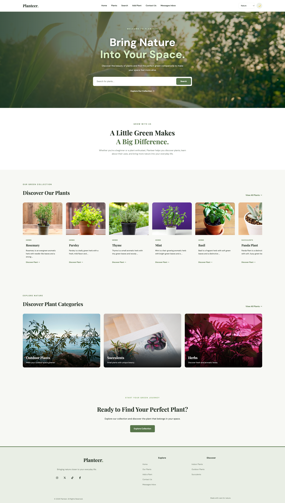
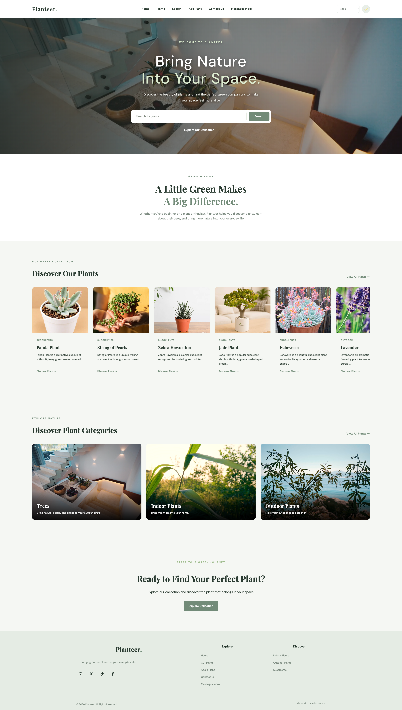
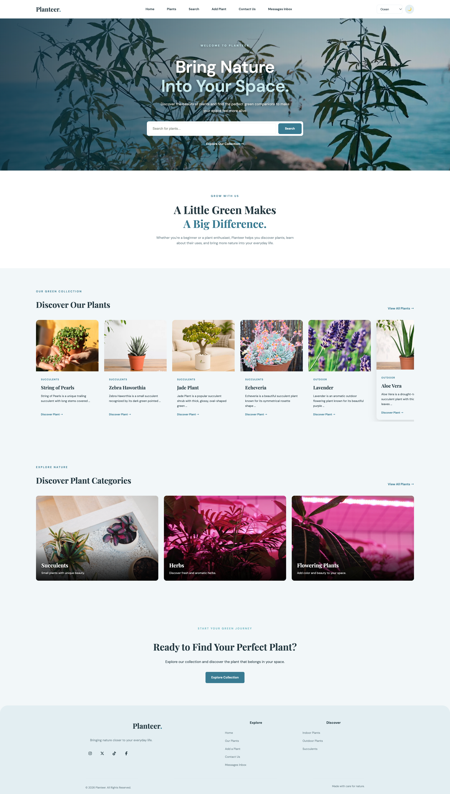
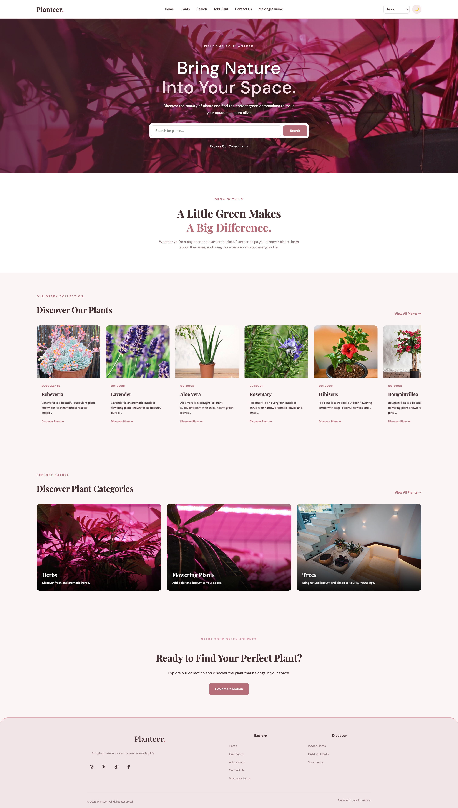
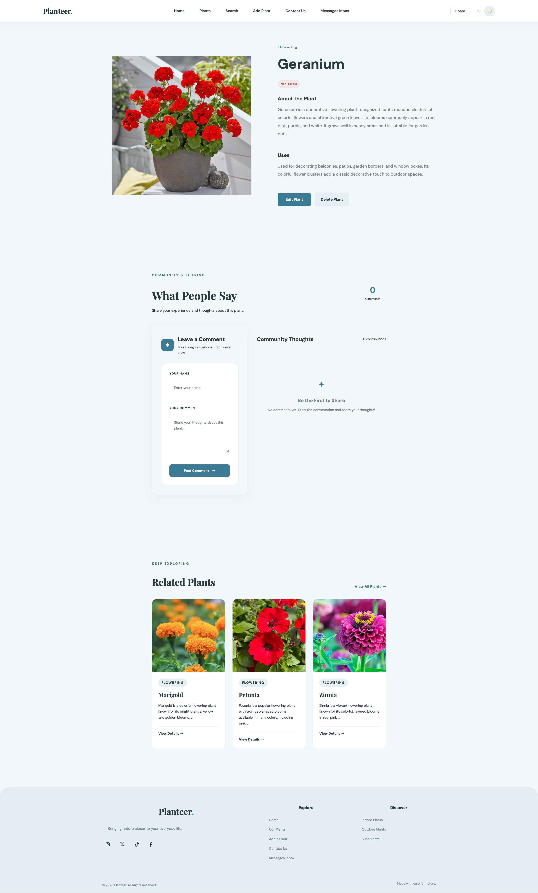
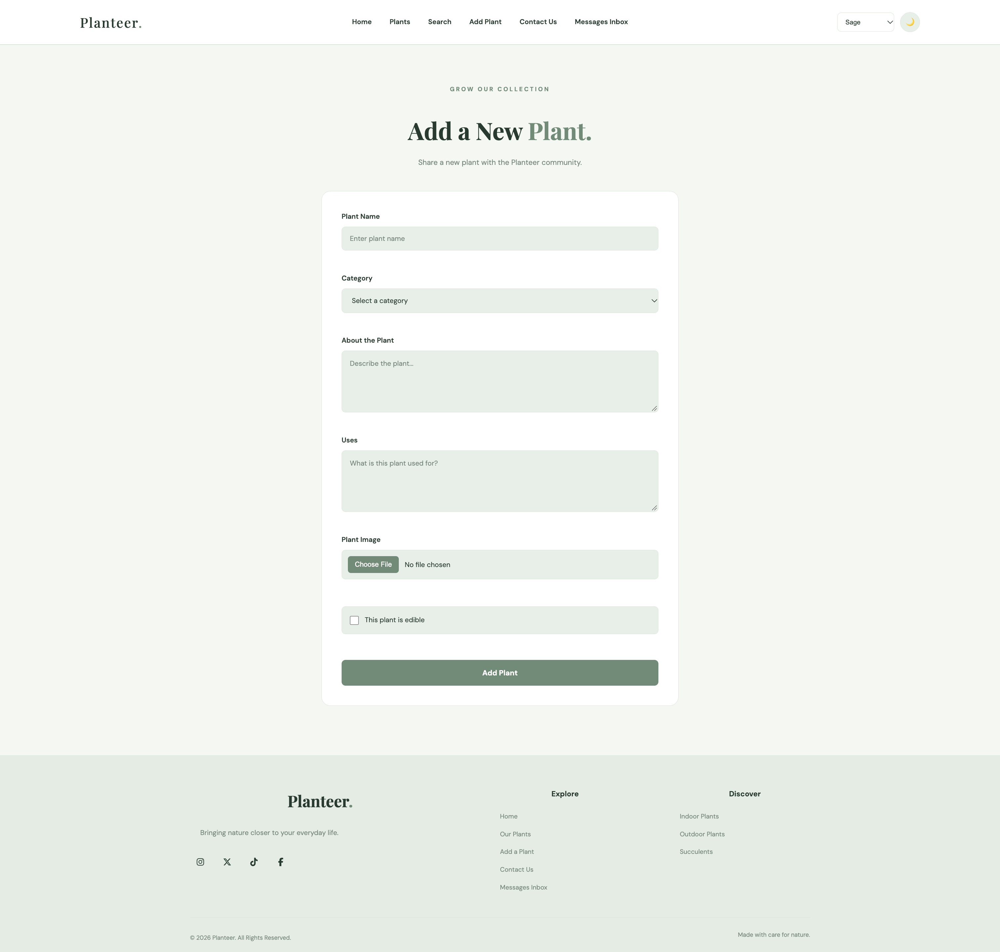
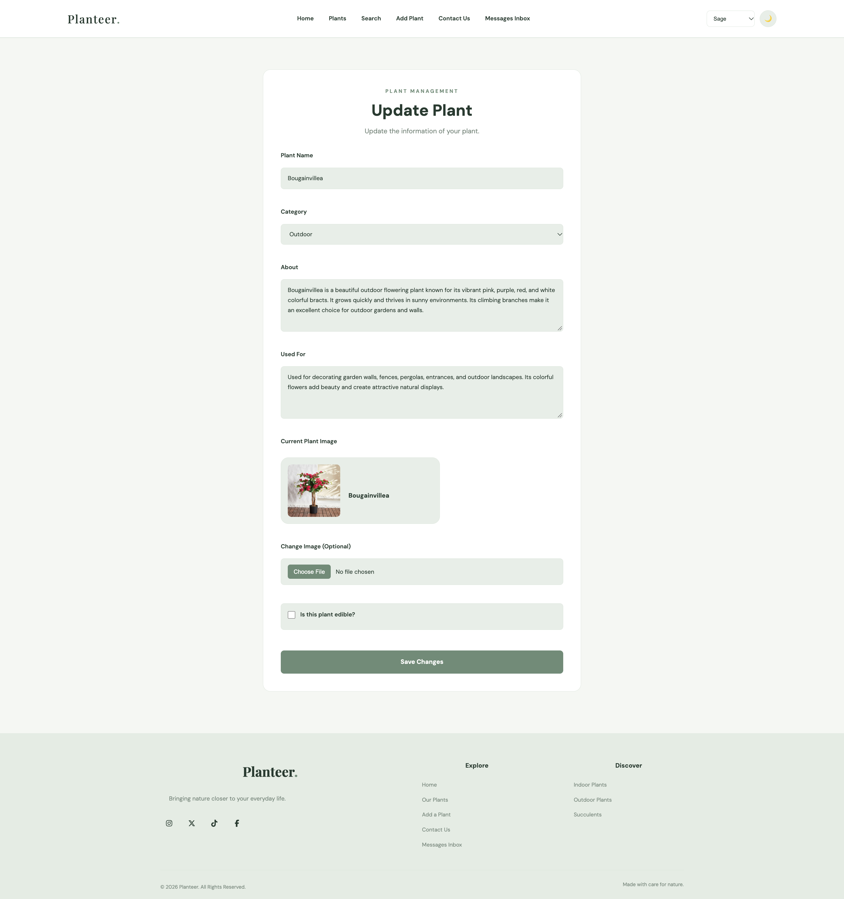
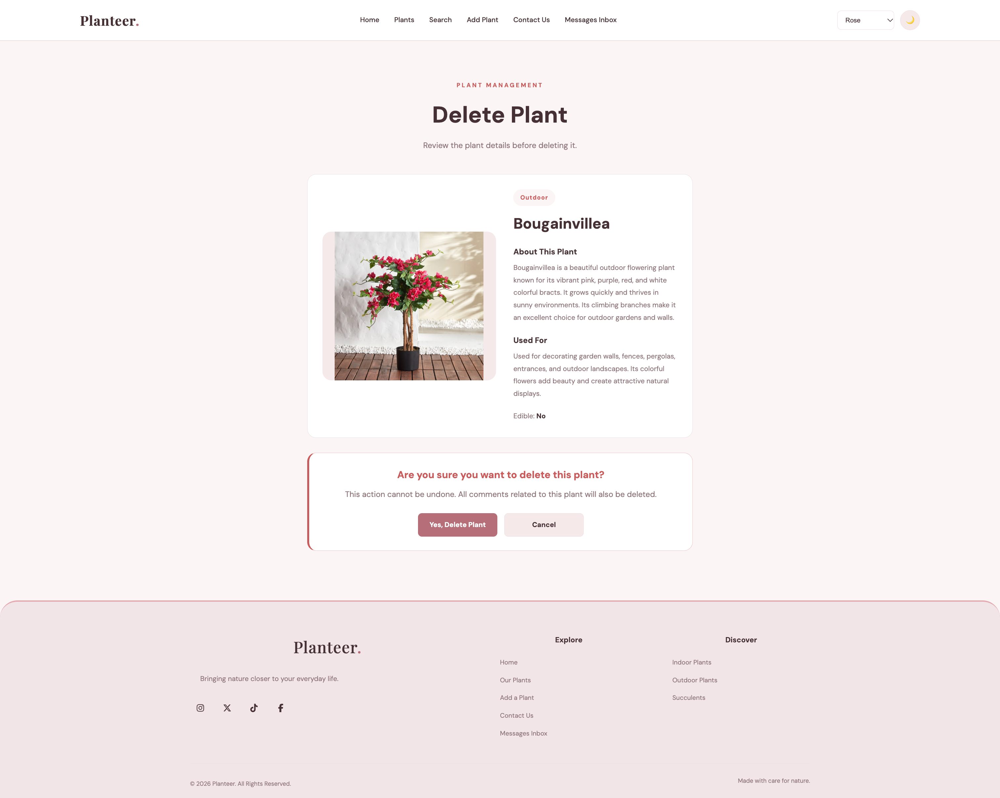
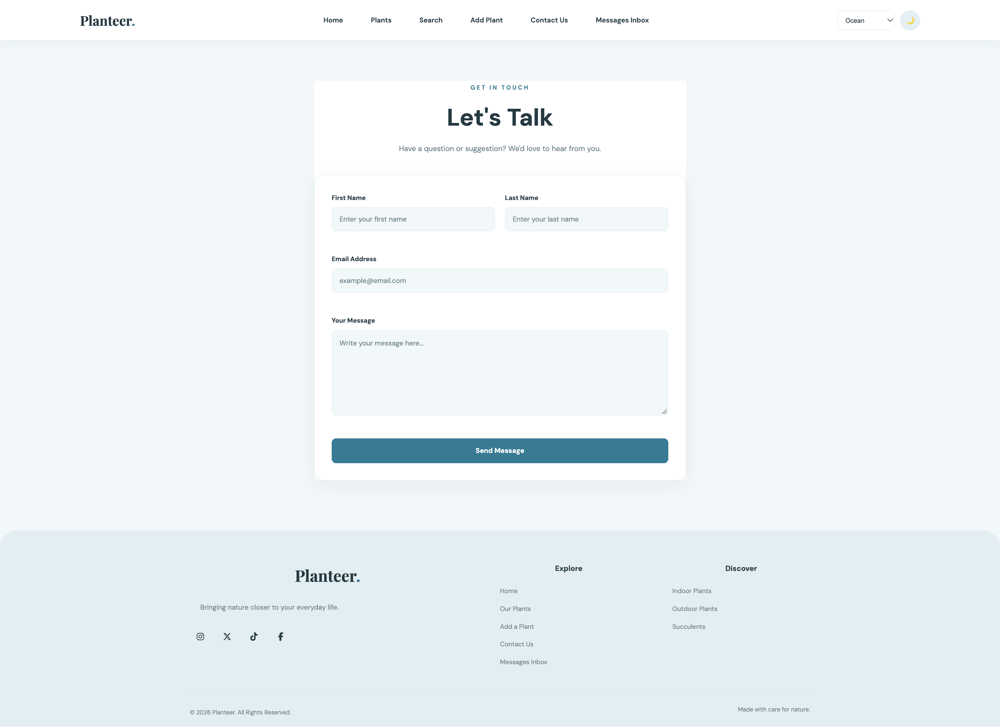
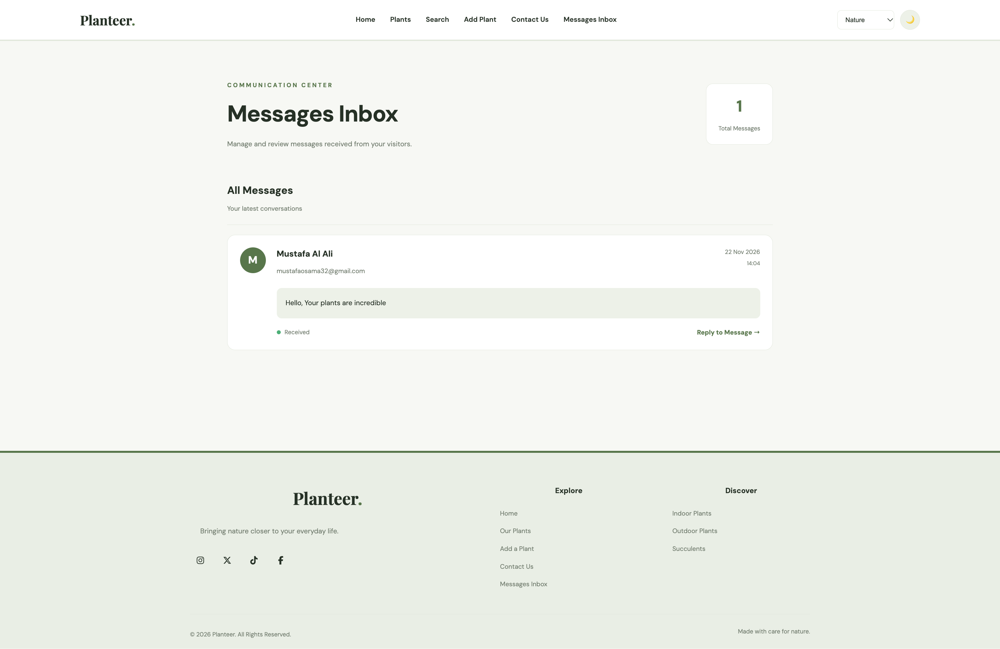

# 🌿 Planteer – Discover Nature

**Planteer** is a Django-based plant discovery and management web application designed to help users explore different types of plants, learn about their benefits, and manage a diverse plant collection through a modern and interactive interface.

---

## ✨ Features

- **Plant Management:** Add, view, update, and delete plants.
- **Plant Categories:** Browse plants across six categories.
- **Live Search:** Search for plants dynamically.
- **Plant Details:** View detailed information about each plant.
- **Comments System:** Share thoughts and experiences about plants.
- **Contact Us:** Submit messages through a contact form.
- **Messages Inbox:** View submitted contact messages.
- **Multiple Themes:** Nature, Sage, Ocean, and Rose.
- **Dark Mode:** Switch between Light and Dark modes.
- **Responsive Design:** Optimized for different screen sizes.
- **Interactive Homepage:** Video backgrounds and animated plant sliders.

---

## 🌱 Plant Categories

| Category | Description |
|---|---|
| Indoor Plants | Plants suitable for indoor spaces |
| Outdoor Plants | Plants that grow in outdoor environments |
| Succulents | Water-storing plants |
| Herbs | Useful aromatic and culinary plants |
| Flowering Plants | Plants known for their beautiful flowers |
| Trees | Different types of trees and their benefits |

---

## 🎨 Themes & Appearance

Planteer includes four unique visual themes, each available in Light and Dark modes.

- Nature
- Sage
- Ocean
- Rose

### Homepage Screenshots

| Nature | Sage |
|---|---|
|  |  |

| Ocean | Rose |
|---|---|
|  |  |

## 📸 Application Screenshots

### All Plants


### Plant Details


### Add Plant


### Update Plant


### Delete Plant


### Search Plants


### Contact Us


### Messages Inbox


---

## 🛠️ Technologies Used

- **Backend:** Python, Django
- **Frontend:** HTML5, CSS3, JavaScript
- **Database:** SQLite
- **Image Handling:** Pillow
- **Icons:** Font Awesome
- **Media:** HTML5 Video

---

## 📂 Project Structure

```text
LAB-ORM-PLANTEER/
│
├── Planteer/
│   ├── Planteer/
│   ├── Main/
│   ├── Plants/
│   ├── templates/
│   ├── static/
│   ├── media/
│   └── manage.py
│
├── static/
│   ├── css/
│   ├── js/
│   ├── images/
│   │   └── screenshots/
│   └── videos/
│
├── templates/
└── README.md
```

---

## 🚀 Installation & Setup

### 1. Clone the repository

```bash
git clone YOUR_REPOSITORY_URL
```

### 2. Navigate to the project directory

```bash
cd LAB-ORM-PLANTEER/Planteer
```

### 3. Create a virtual environment

```bash
python3 -m venv venv
```

### 4. Activate the virtual environment

**macOS / Linux**

```bash
source venv/bin/activate
```

**Windows**

```bash
venv\Scripts\activate
```

### 5. Install dependencies

```bash
pip install django pillow
```

### 6. Apply migrations

```bash
python manage.py migrate
```

### 7. Run the development server

```bash
python manage.py runserver
```

Open your browser and visit:

`http://127.0.0.1:8000/`

---

## 👨‍💻 Project Information

**Project Name:** Planteer  
**Framework:** Django  
**Database:** SQLite  
**Project Type:** Web Application  

---

*Planteer – Bringing nature closer to your everyday life.* 🌿
